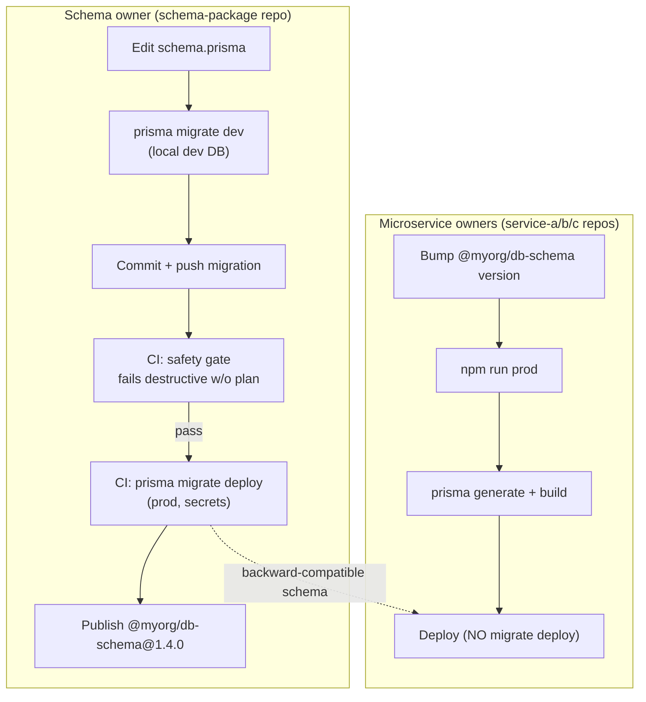

# Sharing a Prisma schema across microservices — the right way

A complete, runnable reference for teams whose microservices live in **separate
Git repositories** but **share one database** and use **Prisma**. It shows how
to get a *single source of truth* for the schema without a monorepo, and how to
make schema changes safe.

- **Problem:** copying `schema.prisma` into every service → drift, migration
  conflicts, deploy-order chaos.
- **Solution:** one `@myorg/db-schema` package owns the schema + migrations and
  is the *only* thing that migrates the database. Services import the client
  and never migrate.
- **Standout feature:** a CI safety gate that fails destructive migrations
  without a written expand-contract plan — the part most tutorials skip.

---

## Table of contents

1. [The problem](#the-problem)
2. [The solution](#the-solution)
3. [How it works (flow)](#how-it-works-flow)
4. [The rules](#the-rules)
5. [Run the demo](#run-the-demo)
6. [What's in this repo](#whats-in-this-repo)
7. [Adopting this in your team](#adopting-this-in-your-team)
8. [Comparison of approaches](#comparison-of-approaches)
9. [Who this is for](#who-this-is-for)

---

## The problem

You have several microservices. Each lives in its own repository. They share a
single Postgres database and all use Prisma.

Every time the schema changes, someone copies `schema.prisma` and the migration
files into every service that needs them. That is where it goes wrong:

- **Schema drift** — three services, three subtly different copies.
- **Migration conflicts** — who runs which migration, in which order?
- **No single source of truth** — the real schema is "whatever the last copy
  was."
- **Deploy-order chaos** — a service breaks the moment a migration it didn't
  know about removes a column it still reads.

---

## The solution

1. A dedicated **`schema-package`** repository owns `schema.prisma` and every
   migration file. It is published as a private npm package
   (`@myorg/db-schema`).
2. Each microservice installs the package and imports the Prisma client from it.
   Services hold **no** schema and **no** migrations.
3. **Only** the schema package's CI runs `prisma migrate deploy` against
   production.
4. A service's `npm run prod` runs `prisma generate` + build only — never
   `migrate deploy`.
5. Every migration is **backward-compatible** (expand-contract), enforced by a
   CI gate that fails destructive migrations without a plan.

---

## How it works (flow)



The arrow that matters is the one that **doesn't** exist: no service ever
migrates the database.

---

## The rules

These are the whole idea. Everything in the repo exists to make them real.

| # | Rule | Enforced by |
|---|---|---|
| 1 | Only `schema-package` CI runs `prisma migrate deploy` on prod | `schema-package-ci.yml`; `service-ci.yml` guard fails any service with a `migrate` script |
| 2 | Services run `prisma generate` + build only | service `package.json` scripts |
| 3 | Migrations are backward-compatible (expand-contract) | `check-migration-safety.ts` fails destructive migrations without a plan |
| 4 | Version pinning + automated bumps | [`.github/dependabot.yml`](.github/dependabot.yml) bumps npm deps; Renovate example for `@myorg/db-schema` in [Adopting](#adopting-this-in-your-team) |

---

## Run the demo

You need Docker (with Compose v2) — nothing else.

```bash
git clone <your-repo-url> prisma-microservices-guide
cd prisma-microservices-guide
docker compose up --build
```

Watch the boot order — it *is* the demo:

1. **`db`** — Postgres starts and becomes healthy.
2. **`migrate`** — the schema-package image runs `prisma migrate deploy` **once**
   and exits. This is the only thing in the whole system that migrates.
3. **`service-a` / `service-b` / `service-c`** — wait for the migration to
   finish, then start. Each only ran `prisma generate` + build.

Then exercise it:

```bash
# create an item through service-a
curl -s -X POST http://localhost:3001/items \
  -H 'Content-Type: application/json' \
  -d '{"name":"widget","quantity":5}'

# read it back through a *different* service (same shared database)
curl -s http://localhost:3002/items
curl -s http://localhost:3002/items/count

# attach a tag through service-c, then see it in service-a
curl -s -X POST http://localhost:3003/tags \
  -H 'Content-Type: application/json' \
  -d '{"name":"red","itemId":"<the-id-from-above>"}'
curl -s http://localhost:3001/items
```

All three services talk to the same schema through the same
`@myorg/db-schema` client — yet no service owns a schema or a migration.

Stop it with `docker compose down` (add `-v` to wipe the database).

---

## What's in this repo

```
prisma-microservices-guide/
├── README.md
├── LICENSE                             # MIT
├── docker-compose.yml                  # Postgres + migrate + 3 services
├── .github/
│   ├── dependabot.yml                  # weekly npm dependency bumps
│   └── workflows/
│       ├── schema-package-ci.yml       # safety gate + migrate deploy (prod)
│       └── service-ci.yml              # generate + build, guard: no migrate
├── schema-package/                     # @myorg/db-schema — single source of truth
│   ├── schema.prisma                   # the schema (the only copy)
│   ├── migrations/                     # all migration files
│   ├── src/index.ts                    # exports the PrismaClient singleton
│   ├── scripts/check-migration-safety.ts   # the CI safety gate
│   ├── scripts/verify-safety-check.ts      # self-test for the gate
│   └── scripts/fixtures/               # pass/fail fixtures for the gate
├── service-a/  service-b/  service-c/  # minimal Express services
└── docs/
    ├── approaches-comparison.md        # monorepo vs package vs schema-per-service
    ├── migration-playbook.md           # add table / column / rename / drop
    └── failure-demos.md                # what breaks without this flow
```

In reality each of `schema-package/`, `service-a/`, `service-b/`, `service-c/`
would be its **own Git repository**. They live in one folder here only so the
demo is a single clone and `docker compose up` just works. No monorepo tooling
is used — no Turborepo, no Nx.

The demo installs the schema package via a `file:` path
(`"@myorg/db-schema": "file:../schema-package"`) so it runs with no registry.
In production you publish `@myorg/db-schema` and depend on a version instead
(`"@myorg/db-schema": "^1.4.0"`).

---

## Adopting this in your team

1. **Create the schema package** — move `schema.prisma` + `migrations/` into a
   new repo, publish as a private package. Start the version at `1.0.0`.
2. **Wire the migrations authority** — add `schema-package-ci.yml`, point
   `migrate-production` at your prod database via a `DATABASE_URL` secret.
3. **Switch services over** — delete each service's `schema.prisma` and
   `migrations/`, add `@myorg/db-schema`, and replace
   `new PrismaClient()` with `import { prisma } from '@myorg/db-schema'`.
4. **Guard the services** — add `service-ci.yml` (its guard fails any service
   that reintroduces a `migrate` script).
5. **Automate version bumps** so services track the schema package:

   ```jsonc
   // renovate.json (or .github/dependabot.yml)
   {
     "packageRules": [
       {
         "matchPackageNames": ["@myorg/db-schema"],
         "enabled": true,
         "schedule": ["after 10am on monday"]
       }
     ]
   }
   ```

6. **Adopt expand-contract** — point your team at
   [`docs/migration-playbook.md`](docs/migration-playbook.md) and make the
   safety gate part of every schema change.

---

## Comparison of approaches

Monorepo shared package vs. separate repos + npm package vs. schema-per-service
— trade-offs and when to pick each:
[`docs/approaches-comparison.md`](docs/approaches-comparison.md).

---

## Who this is for

Backend and full-stack engineers who run microservices in **separate repos**
against a **shared database** and use **Prisma** — and who are tired of copying
`schema.prisma` around. It's meant to be the reference you can link when someone
asks *"how do I share a Prisma schema across microservices?"* — practical,
honest about the trade-offs, and runnable in five minutes.
